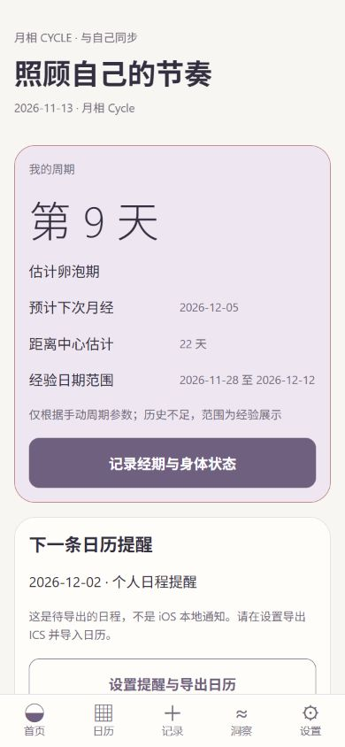
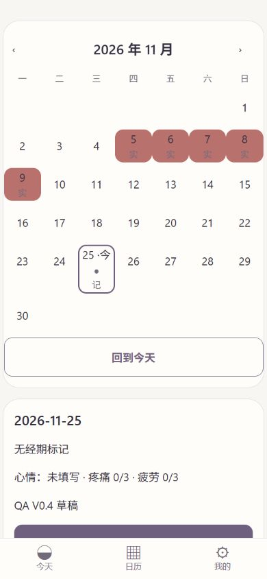
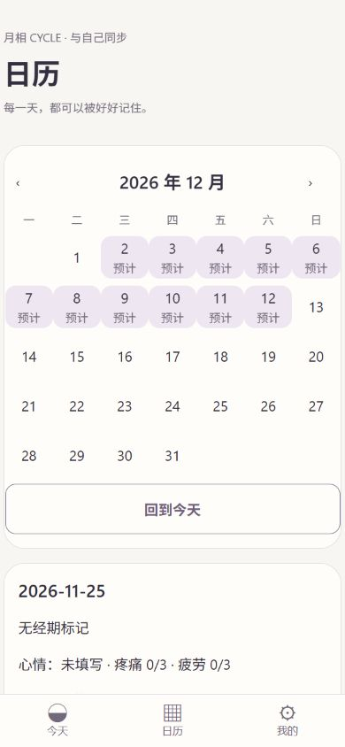
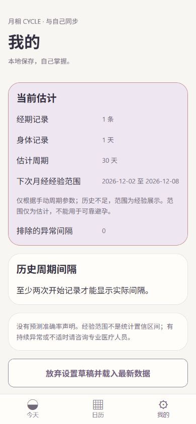

# V0.4.0 RC1 本地验收报告

日期：2026-11-25。状态：待 iPhone 真机验收的候选版；未 Push、未公开部署。

## 改动

- 建立 checkpoint/before-v0.4，保留旧标签与历史提交。
- 底部五栏缩为今天、日历、我的；旧 /record、/insights 路由仍兼容访问。
- 今天只显示周期天数、下次月经日期及可能范围、记录入口和必要的异常经期核对。不显示排卵结论。
- 首页与日历共用真实可编辑的记录面板，保留经期、流量、症状、心情、备注及历史编辑与删除确认。
- 身体记录切换日期自动加载对应内容；有未保存草稿时明确确认；关闭面板也有草稿确认。
- 日历真实经期为珊瑚色，预测为淡色可能区间，今日有边框与“今”，身体日志有圆点。文字辅助标记保留。
- 我的整合周期统计、历史间隔、参数、ICS 提醒、JSON 备份恢复、隐私、迁移与版本入口。
- 保留超过14天未结束经期核对、未知结束日期待确认、异常间隔排除、Web Share 分享及下载回退。
- 数据库、Repository 与 schema 3 未改变；未操作用户原有数据库，未自动删除或修改异常记录。
- 锁文件只更新顶层应用版本与根包版本；所有依赖、下载 URL 和 integrity 保持检查点一致。

## 验证结果

| 类别 | 结果 |
| --- | --- |
| TypeScript / ESLint | 通过 |
| 自动化测试 | 51/51，原49项保留，新增2项日期草稿测试 |
| 已有回归范围 | 周期日期算法、异常未结束经期、IndexedDB持久化/迁移/回滚、备份兼容/验证/恢复失败、分享成功/取消/下载回退、Service Worker版本隔离 |
| Expo Doctor | 19/20：现有 expo 58.0.25、expo-router 58.0.31、expo-sqlite 58.0.17 低于目前建议的58.0.26、58.0.32、58.0.18；未擅自升级依赖，无其他检查失败 |
| 生产 Web / PWA / ZIP | 通过；/cyclemoon 子路径，50个缓存资源、53个ZIP文件 |
| HTTP资源校验 | 61项通过，状态码、内容、MIME、图标尺寸、缺失JS返回404 |
| 桌面移动视口 | 320/375/390/430px × 三页，3个Tab，未发现横向溢出 |
| 浏览器交互 | 首页/日历共用记录、保存历史经期、保存30天/5天参数、日期切换保留/放弃草稿、关闭继续编辑/明确放弃均验证 |
| 刷新与版本更新 | 独立localhost:4230合成数据，2026-11-05至11-09经期、30/5设置、身体日志在更新并刷新后仍存在；最终“我的”标题与新资源生效 |
| 离线冷启动/写入 | 停止本轮自己的HTTP服务，关闭测试页后重新打开/cyclemoon/calendar；读取旧记录、离线修改备注，保存后刷新仍存在 |
| 备份恢复与升级 | 自动化兼容/迁移/失败恢复测试通过；本轮未额外执行iPhone文件App导入导出或真实V0.3→V0.4设备升级 |
| iPhone Safari / 主屏幕 / 键盘 / 系统分享 | 未验证；桌面模拟不能代替真机 |
| 线上GitHub Actions与部署 | 未执行 |

测试为本地合成数据，不作为正式默认用户记录。当前日期下周期第21天，预计2026-12-05，开始日可能范围12-02至12-08；日历淡色区间还覆盖可能经期持续天数，不能用于可靠避孕。

## 截图

改版前为仓库已有V0.3截图，拍摄日期/数据不同，仅比较信息布局，不对比算法数值。

| 改版前 | 改版后 |
| --- | --- |
|  |  |

屏宽测量见 qa/v04-responsive-metrics.json。所有新截图均为本地合成数据。

## 候选产物与复现

ZIP：F:\新项目\月相\artifacts\cyclemoon-pwa-0.4.0-834139cb681eedba-static.zip

SHA-256：e4ecae93d51eb08486bbae95d97772315df40de737f3a5396d61e6f9856f3ce8

内容版本：834139cb681eedba。ZIP根目录直接为index.html、_expo、icons等，无多余dist层级。此包为GitHub Pages的/cyclemoon/子路径构建，不应原样用于根域名托管。

~~~powershell
npm run typecheck
npm run lint
npm test
npx expo-doctor
$env:EXPO_PUBLIC_BASE_PATH='/cyclemoon'
npm run export:web
npm run package:web
npm run check:http
npm run serve:web
~~~

默认本地地址 http://localhost:4173/cyclemoon/。本轮测试专用4230服务已停止。

## 发布前与限制

1. 上传前先在原站“我的”导出JSON备份，备份未加密，不要提交Git。
2. 在GitHub Desktop检查差异；Push origin会触发已有自动部署。无需新建站点或删除Cloudflare站点。
3. 同源同路径更新仍使用原IndexedDB；Service Worker不清除数据库，保留旧资源缓存避免旧页面缺块。浏览器仍可能因清理或配额丢失数据，必须独立备份。
4. 换域名不会自动迁移，Safari与主屏幕数据也可能不共享；先导出、预览恢复、核对，再决定后续操作。
5. iPhone真机检查：首页三Tab、日历点击历史日期、保存后刷新、键盘出现时滚动到保存按钮、Home Indicator距离、系统分享保存JSON到文件、恢复预览与覆盖确认、主屏幕断网冷启动与写入、更新后记录保留。
6. ICS为一次性日历副本，数据变化不会更新旧事件；没有真正iOS本地通知。JSON仍未加密。
7. Expo Doctor补丁版本提示应在独立依赖维护变更中处理并复测；目前不能声称全部环境检查或真机验收通过。

## 修改文件

package.json、package-lock.json、app.json；scripts/build-pwa.mjs、package-web.mjs；src/app/_layout.tsx；components/sheet.tsx；domain/backup.ts、record-draft.ts；features/cycle/home-screen.tsx、calendar/calendar-screen.tsx、records/record-screen.tsx、insights/insights-screen.tsx、settings/settings-screen.tsx；tests/backup.test.mjs、record-draft.test.mjs；README.md、docs/CHANGELOG.md、GITHUB_PAGES.md、本报告与qa/v04-*验收文件。
